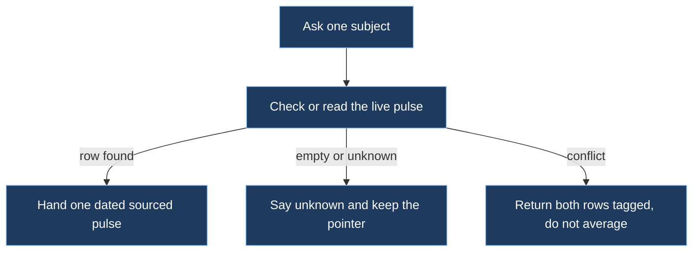

# verified-retrieve

## Spec

| Rule | Do | Do not |
|------|----|--------|
| One pulse | Return the live row for this next action | Paste a transcript, history dump, or whole store |
| Freshness | Prefer later time, then higher status | Blend two stories into one fluent paragraph |
| Status | `tool-verified` > `user-stated` > `inferred` > `unknown` | Promote an inferred fill to locked |
| Empty check | If check or prefetch is empty, say unknown and keep the pointer | Backfill from archive or invent a value |
| Conflict | Tag both rows and leave them in evidence | Average, or pick a side to sound sure |

Hint tags on every pulse you hand on: `source`, `time`, `status`, `kind`. Untagged text is a hypothesis.

When the kernel is present, stay on the read path: `ensembly pulse check`, `pulse read`, or `pulse list` (live memory). `pulse history` is archive. Use it only when you must trace a supersession, not as default context.

When the kernel is absent, ask the store you have for one dated row with the same tags (pulse-memory is the usual companion). Still do not dump.

After retrieve, if the next step is a write, load `record-layer`.
